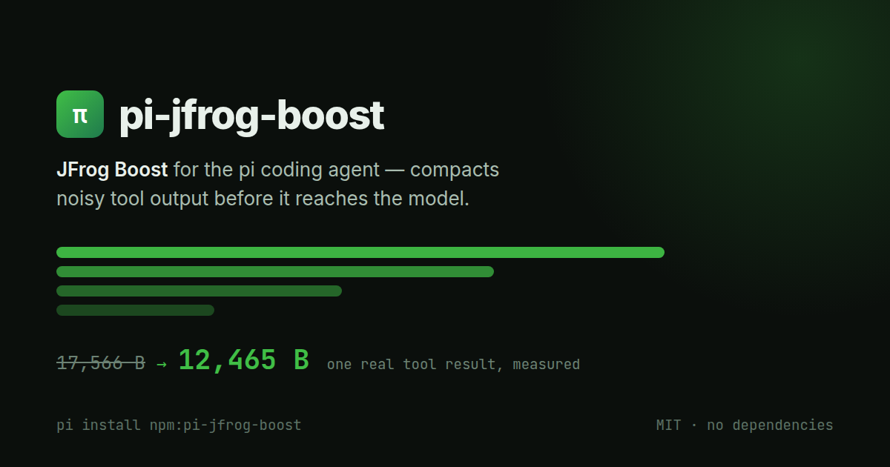

<div align="center">



# pi-jfrog-boost

**Fewer tokens from noisy test runs, documents and MCP tools in [pi](https://pi.dev), via [JFrog Boost](https://boost.jfrog.com/).**
Exact file reads, fail-open, zero dependencies.

[](https://www.npmjs.com/package/pi-jfrog-boost)
[](https://pi.dev/packages/pi-jfrog-boost)
[](https://github.com/darkdiamond/pi-jfrog-boost/actions/workflows/ci.yml)
[](https://search.sigstore.dev/?q=pi-jfrog-boost)
[](https://scorecard.dev/viewer/?uri=github.com/darkdiamond/pi-jfrog-boost)
[](https://nodejs.org)
[](./LICENSE)
[](./package.json)

</div>

```sh
pi install npm:pi-jfrog-boost
```

> A community project. Not affiliated with, endorsed by, or supported by JFrog.

## What you get

After a tool runs, pi-jfrog-boost hands its output to the local `boost` CLI and
gives the model Boost's shorter version. Measured on Boost v0.15.4, 2026-10-13:

| Output | Before | After |
|---|---|---|
| failing `npm test` (node TAP, 3 failures) | 21,088 B | 3,146 B |
| `node --test` spec reporter | 10,335 B | 3,927 B |
| Jupyter notebook, read whole | 120,366 B | 5,718 B |
| PDF (3 pages) | binary | 4,529 B text |
| Slack MCP user list | 19,058 B | 10,438 B |
| Playwright MCP browser snapshot | 209,690 B | 3,939 B |

Left alone, because Boost has nothing to take out or because it must stay exact:
`git diff` and `git log`, `tsc` errors, source files, JSON, and pi's `grep`,
`find` and `ls`.

A shortened result ends with a marker such as
`[Boost compressed ~85%. Get the full original output simply with: boost retrieve 147]`,
and the model is told how to get back just the part it needs (`boost retrieve`
needs the Preview Agreement; see below). If Boost is missing, slow or failing,
the original output is used.

## Before you start

- **Shell compaction is opt-in in Boost.** Since Boost 0.14.6, CLI filtering
  is off unless you turn it on. pi follows Boost's `boost-cli-filtering` flag
  by default, and the footer says `shell off` when it is off. To turn it on for
  pi alone: `/boost settings` → **Shell output: on**. That only sets an
  environment variable on pi's own Boost calls; Boost's config is never
  written.
- **Documents and `boost retrieve` need Boost's Preview Agreement.** PDF,
  Office and notebook conversion (`boost read`) refuses to run until the
  [Preview Agreement](https://boost.jfrog.com/preview-agreement/) is accepted.
  Shell and MCP compaction run without it and still end shortened results
  with a `boost retrieve` marker, but `boost retrieve` refuses too, so what
  they dropped cannot be recovered: the only way back to a command's exact
  output is re-running it with `DISABLE_BOOST=1`, and the model is told so.
  This package never accepts it for you: run `boost init --dry-run`, then
  `boost init`, in a terminal (init also offers to add Boost hooks to other
  agents).

## Install

```sh
pi install npm:pi-jfrog-boost      # or: pi install git:github.com/darkdiamond/pi-jfrog-boost
pi -e npm:pi-jfrog-boost           # try it without installing
```

The extension needs the `boost` binary. If it is missing, pi says so once and
the footer reads `boost: not installed (/boost install)`. `/boost install`
asks before doing anything and offers four choices:

1. **Binary only (recommended).** Looks up the latest release on the GitHub
   API, downloads `boost-<os>-<arch>.tar.gz` from github.com/jfrog/boost,
   checks it against the SHA-256 GitHub publishes for it (with no published
   digest it installs nothing and shows the manual steps), and puts the `boost` binary in `~/.local/bin`.
   That is all: it does not run JFrog's `install.sh`, change your shell
   startup files or PATH, run `boost init`, add hooks to other agents, or
   accept the Preview Agreement. macOS and Linux, amd64 and arm64.
2. **Official installer, unchanged.** Downloads
   `https://boost.jfrog.com/install.sh` in full, then runs it with `bash` in
   your real environment (a failed or cut-off download runs nothing and is
   reported as a failure). It may add `~/.local/bin` to your shell rc files, and if
   `~/.local/bin` is already on your PATH it runs `boost init --accept-terms`,
   which accepts the Preview Agreement on your behalf and installs Boost hooks
   for Claude Code, Cursor, Codex, Copilot and OpenCode.
3. **Show the commands; I'll run them myself.**
4. **Cancel.**

No restart is needed afterwards. On Windows, and without a UI, it only prints
what to run. To do it by hand:

```sh
# binary only (os: darwin|linux, arch: amd64|arm64)
curl -fsSLO https://github.com/jfrog/boost/releases/latest/download/boost-darwin-arm64.tar.gz
shasum -a 256 boost-darwin-arm64.tar.gz   # compare with the digest on the release page
tar -xzf boost-darwin-arm64.tar.gz boost && mkdir -p ~/.local/bin && mv boost ~/.local/bin/ && chmod 0755 ~/.local/bin/boost

# or JFrog's installer (see option 2 for what it also does)
curl -fsSL https://boost.jfrog.com/install.sh | bash
```

The binary is found at `$BOOST_BIN` (or `$BOOST_EXE`), then `~/.local/bin`,
then `%LOCALAPPDATA%\boost\bin` on Windows, then `PATH`. When it is not on
PATH, the model is given its full path.

## What it covers

| pi tool | What happens |
|---|---|
| `bash`, `powershell` | Output of 2 KiB to 1 MiB goes through Boost's filter **when shell compaction is on**. Failed commands are compacted too and stay errors; pi's own notices (`Command exited with code 1`, `Full output: …`) are kept verbatim. |
| `bash` output pi truncated | Boost filters pi's full output file instead of the tail pi kept, so failures near the start of a long run are not lost. Used only when the result fits one pi page. On pi 1.x this covers every run; on pi 0.86 only runs that exit 0, because a failed command there keeps pi's tail (pi 0.86 does not record the file's path for a failed command). |
| `read` of `.pdf .docx .xlsx .pptx .odt .ods .odp` | Converted to text by `boost read`, paged exactly like pi's own `read` (2000 lines / 50 KB, `offset` to continue), with a first line saying it was converted. |
| `read` of a `.ipynb` of 16 KiB or more, whole | Converted to Markdown (needs `documents` and the Preview Agreement). A read with `offset=1` returns the raw JSON. |
| `read` of legacy `.doc .xls .ppt` | Boost cannot convert these; the model gets a clear error asking for a modern or text export, instead of binary noise. |
| `read` of `*.log` / `*.out`, whole | Compacted only if you turn on `readLogs` **and shell compaction is on** (off by default: a generic log can trip the wrong filter). |
| `mcp__<server>__<tool>` results | Compacted by Boost's MCP filters (Slack, GitHub, GitLab, Atlassian, Linear, Notion, Sentry, browser snapshots and more) **when the model calls the tool directly**: on pi 1.x that means `"exposure": "direct"` or `"deferred"` (see [MCP exposure](#mcp-exposure)). Images and `structuredContent` are kept. |
| everything else | Never touched. |

**Never changed:** `read` of text files (source, JSON, Markdown, HTML, CSV,
SVG), `edit`, `write`, `grep`, `find` and `ls`. A lossy read would break
`edit`'s exact-match, HTML would be turned into Markdown, and pi's `grep`,
`find` and `ls` output never compacts on Boost 0.15.4 anyway. Also never
changed: output under 2 KiB, HTML pages printed by anything but a web fetch
(`curl`, `wget`, …), commands that run `boost` themselves, commands prefixed
with `DISABLE_BOOST=1`, a reply that saves less than 256 bytes or 5%, and tool
calls made from inside another tool (codemode).

### MCP exposure

pi 1.x gives an MCP server `"exposure": "codemode"` by default. Its tools are
then not declared to the model and are only called from inside a `codemode`
script, and those nested calls are never changed (see above). The script's
result reaches the model as it is, so **with the default exposure no MCP
output is compacted**. To have Boost compact a server's results, let the model
call its tools directly, in `~/.pi/agent/mcp.json` or `.pi/mcp.json`:

```json
{
  "mcpServers": {
    "slack": {
      "command": "npx",
      "args": ["-y", "<your-slack-mcp-server>"],
      "exposure": "direct"
    }
  }
}
```

`"deferred"` works too (the model calls the tool after `tool_search` loads
it), and `toolExposure` sets it for single tools, e.g.
`"toolExposure": { "browser_snapshot": "direct" }`. `/mcp` in pi changes
exposure interactively.

The extension also adds a short `jfrog-boost` section to the system prompt,
naming only what is active this session and how to recover dropped detail,
and ships a `boost` skill with the longer version.

## Using it

**Footer.** The `jfrog-boost` status shows the current state, in plain text:

| Footer | Meaning |
|---|---|
| `boost ✓ ~12.3k saved (41%)` | Working; estimated tokens saved this session |
| `boost ✓ shell off` | Working, but Boost's shell compaction is off (documents and MCP still work) |
| `boost: off` | Turned off by `DISABLE_BOOST`/`BOOST_DISABLED`, `--no-boost`, `/boost off` or settings |
| `boost: not installed (/boost install)` | No `boost` binary found |
| `boost: v0.12.1 too old` / `boost: version unknown` | Older than 0.13.13, or an unrecognised version banner |
| `boost: not responding` | `boost version` hung or failed; retried later |
| `boost: paused (slow)` | Boost was slow or failing; paused for 5 min or more, output passes through |

**`/boost`** opens a menu, or takes a subcommand:

| Command | What it does |
|---|---|
| `/boost status` | State, binary and version, which surfaces are on and why, breaker, savings, skip counts |
| `/boost on` / `off` | Turn Boost on or off for this session |
| `/boost settings` | Change and save the settings below |
| `/boost stats` | Savings by tool this session |
| `/boost report` | `boost report -t`, Boost's own measured savings |
| `/boost doctor` | `boost doctor` |
| `/boost install` | Install or update the Boost CLI (asks first). `/boost-install` is an alias. |
| `/boost help` | What each subcommand does |

**Start pi with Boost off:** `pi --no-boost=true "your prompt"`. Write the
`=true`: pi's parser takes the next argument as the flag's value, so
`pi --no-boost "fix it"` turns Boost off but swallows the prompt
(`--no-boost` followed by another `-` flag also works). Any value, even
`--no-boost=false`, turns it off.

**One command's exact output:** the model can prefix a command with
`DISABLE_BOOST=1` or `BOOST_DISABLED=1` (your own `!cmd` output is never
compacted). Set either in pi's own
environment to turn the extension off for the whole process.

## Settings

Settings live in one global file, `~/.pi/agent/jfrog-boost.json` (or
`$PI_CODING_AGENT_DIR/jfrog-boost.json`, or `$PI_JFROG_BOOST_SETTINGS`), and
are easiest to change with `/boost settings`. The file has a
[JSON schema](./settings.schema.json).

| Key | Default | Env | What it does |
|---|---|---|---|
| `enabled` | `true` | | Persisted master switch |
| `shell` | `"auto"` | `PI_BOOST_SHELL` | `auto` follows Boost's `boost-cli-filtering` flag; `on` forces it for pi's own Boost calls (env only); `off` never sends shell output |
| `fullOutput` | `true` | | Re-filter pi's full output file when `bash` output was truncated |
| `minBytes` | `2048` | | Skip shell and log output smaller than this |
| `documents` | `true` | `PI_BOOST_DOCUMENTS` | Convert PDF/Office/ODF reads (needs the Preview Agreement) |
| `notebooks` | `true` | | Convert whole reads of `.ipynb` of 16 KiB or more (needs `documents` and the Preview Agreement) |
| `readLogs` | `false` | | Compact whole reads of `*.log` / `*.out` through the shell filter (needs shell compaction on, like `bash`) |
| `mcp` | `true` | `PI_BOOST_MCP` | Compact `mcp__*` results |
| `mcpExclude` | `[]` | | MCP tool name globs never sent to Boost, e.g. `["mcp__secrets__*"]` |
| `extraTools` | `[]` | | More tool names routed like `bash`, e.g. `["fetch"]` |
| `footer` | `true` | | Show the footer status |
| `badges` | `true` | | Per-result transcript badge (pi ≥ 1.0.1) |
| `awareness` | `true` | | The system prompt section |
| `sync` | `true` | `PI_BOOST_SYNC` | Run `boost sync` when the agent settles (uploads to JFrog) |
| `observe` | `false` | `PI_BOOST_OBSERVE` | Lifecycle telemetry to Boost, including tool output excerpts |

The per-key env booleans (`PI_BOOST_*`) take `0/1/true/false/yes/no`; the
kill switches `DISABLE_BOOST`/`BOOST_DISABLED` take only `1` or `true`. Precedence, highest first:
`DISABLE_BOOST`/`BOOST_DISABLED`, `--no-boost`, `/boost on|off`, the per-key
env, the file, the defaults. `/boost on` cannot override a kill switch and
says which one is blocking; changing Enabled in `/boost settings` (or
resetting) ends the session's `/boost on|off`. An invalid value falls back to its default with
one warning.

**There is no project settings file, on purpose.** These settings decide what
leaves your machine (sync, MCP bodies, observe) and which binary runs; a
repository you clone should not be able to change either.

## Attribution and telemetry

Boost has no `pi` agent type. Measured on Boost v0.15.4:

| What pi runs | Span `session.agent_type` | Boost session list (`conversations.tool`) | Other |
|---|---|---|---|
| stdin filter, `boost read` | `pi` | `claude_code` (Boost does not recognise `pi`) | — |
| `boost hook claude` (MCP) | `claude_code` | `claude_code` | `mcp_tool_calls.agent_type = claude_code`, no conversation id |
| `boost hook observe claude` (opt-in) | `pi` (never rewrites earlier spans) | `claude_code` | creates and closes `agent_tool_calls` rows |
| `boost sync` | unchanged | unchanged | uploads, then prunes local rows (≥ 0.13.29) |

MCP results go through `boost hook claude` because that is the only Boost
surface that runs its MCP filters. This replaces the v0.13.24 table in earlier
releases, which said observe overwrote pi's attribution; on v0.15.4 it does
not.

What leaves your machine, and how to stop it:

- **`boost sync`** runs 8 s after the agent settles and on shutdown
  (`boost sync --max-batches 20`, detached, killed after 120 s). It uploads
  Boost's local measurements to JFrog, as every Boost integration does, then
  prunes the synced rows locally. It never runs while Boost is too old, not
  responding or otherwise not ready. Turn it off with `sync: false` or
  `PI_BOOST_SYNC=0`. Boost's own telemetry opt-out also stops it at the
  source: with `boost init --no-telemetry` (`[tracing] telemetry = false` in
  `~/.boost/config.toml`) or `BOOST_TELEMETRY=0`, Boost records no trace rows
  and sync has nothing to upload (measured on v0.16.11). `/boost status`
  shows when that is the case.
- **MCP bodies.** For every MCP call it filters, Boost stores the full request
  and response in its local database, and sync uploads them. Keep a server
  away from Boost with `mcpExclude` (e.g. `["mcp__secrets__*"]`) or turn MCP
  off with `mcp: false`.
- **Shell and log output.** For every shell command (and, with `readLogs`,
  log read) it filters, Boost stores the full original output and the command
  line in its local database; that is what `boost retrieve` reads. Whether
  sync uploads these rows has not been verified. Shell output: off (the
  default while Boost's CLI filtering is off), `readLogs: false`, or
  `DISABLE_BOOST=1` on one command keeps output away from Boost.
- **Observe** is off by default. When on, it records session start, each
  tool's start and end (arguments and an output excerpt, each capped at 16k
  characters, and the duration), the assistant's last reply when the agent
  settles, and compaction events in Boost's local database, which sync
  uploads. It never sends your prompts, nested tool calls, or anything about
  a tool in `mcpExclude`.

### Boost features pi does not use

- **Half Boost** (Boost's with/without-Boost experiment, the
  `boost-measurement-mode` flag) assigns some sessions of Boost's own agent
  integrations to a control group. It does not reach pi: on v0.16.11 every
  pi session tested was filtered, and Boost recorded no measurement mode for
  it.
- **`BOOST.md` lessons** (v0.16.0+), which Boost Pro's local models write from
  past sessions, reach other agents through Boost's Claude Code
  `SessionStart` hook. That hook also indexes the workspace for BoostGraph,
  writing into the project, so pi does not call it, and the lessons are not
  added to pi's prompt.

## Performance

- An eligible call costs the time Boost takes: about 0.2 s for a small
  output, about 0.8 s for 200 KB (Boost v0.15.4, macOS). Small
  outputs (under 2 KiB) are not sent, and nothing over 1 MiB is, except pi's
  full-output file for a result pi truncated, which is capped at 2 MiB.
- Timeouts: `min(10 s, 3 s + 4 ms per KiB)` for shell and MCP, 20 s for a
  document, 8 s for `boost version`. At most four Boost processes run at
  once; a fifth result passes through instead of waiting.
- **Breaker.** Three calls in a row that timed out, crashed or were very slow
  pause Boost for 5 minutes (a non-zero exit from Boost does not count)
  (then one trial call; up to 30 minutes if it keeps failing). The footer
  says `paused (slow)` and output passes through unchanged. `/boost on` or
  `/boost status` → retry resets it.
- **Feature-flag stalls.** Boost refreshes its feature flags on the hot path
  when they are older than their TTL; offline that waits about 5 s per call.
  pi's calls set `BOOST_FEATURE_FLAGS_TTL=24h` (unless you set it) and skip
  the refresh entirely when the cached flags are missing or older than the
  TTL, so a call stays near 0.2 s. Flags are then refreshed by the idle-time
  `boost sync` or by any other Boost integration. **With sync off and no other
  Boost agent on the machine, they are not refreshed at all**, and
  `/boost status` says so on its `flags` line: `stale (N days old); not
  refreshed: sync is off` (hours under a day), `never fetched; …` when Boost
  has never fetched them, or `last update time unreadable; …` when the
  recorded time is not a time.
- The readiness check never blocks a tool: results pass through until
  `boost version` has answered (~160 ms).

## Compatibility

| | Tested | Accepted, untested | Notes |
|---|---|---|---|
| **pi** | 0.86.1, 1.2.0, 1.4.0 | other versions from 0.86.1 | CI typechecks and unit-tests 0.86.1 and ^1.4.0, plus pi@latest weekly |
| **Boost** | 0.15.4, 0.16.11 | 0.13.13 – 0.16.x, and newer than 0.16.x | `/boost status` says "newer than validated" past 0.16.11 |
| **Node** | 22.23 | 22.19 and newer | CI matrix (unit tests): 22.19, 24 — pending until CI is green on the release commit |
| **OS** | macOS | Linux, Windows | CI matrix (unit tests): Linux, Windows, macOS — pending until CI is green on the release commit |
| **Forks** (oh-my-pi and others) | — | unsupported | `extraTools` can route renamed shell tools |

"Tested" means the hermetic end-to-end suite passed against the real Boost
binary on that pi version, Node version and OS. On pi 1.2.0 every case runs; on
pi 0.86.1 the nested-call case and the three real-session MCP cases skip, since
0.86 has no nested tool calls and no built-in MCP. MCP on 0.86 is covered only
through a stub host, not a real MCP extension. Some features depend on the versions:

- **MCP** needs `mcp__<server>__<tool>` tools (pi ≥ 0.99's built-in MCP, or an
  MCP extension on older pi) and Boost ≥ 0.15.3 (MCP filters).
  On pi 1.x only tools with `direct` or `deferred` exposure are compacted;
  the default `codemode` exposure leaves MCP output untouched (see
  [MCP exposure](#mcp-exposure)).
- **Badges** need pi ≥ 1.0.1 (`registerToolRenderer`).
- **Documents** need the Preview Agreement accepted.

## Compared with RTK-based pi extensions

RTK-based extensions rewrite the command before it runs (`git status` →
`rtk git status`). Boost, here, filters the output after the tool has run, so
the command in the transcript is exactly what ran and a missing or broken
Boost cannot block it. Boost also converts documents and filters MCP results,
which command rewriting cannot reach. If you use both, turn shell output off
in one of them (`/boost settings` → Shell output: off, or RTK's own switch) so
the same output is not filtered twice.

## Troubleshooting

**The footer says `shell off`.** Boost's CLI filtering flag is off, which has
been Boost's default since 0.14.6. `/boost settings` → Shell output: on turns
it on for pi only. `/boost status` shows where the flag value came from.

**`boost: paused (slow)`.** Three Boost calls in a row timed out, crashed or
were very slow.
Output passes through unchanged until the pause ends. `/boost status` shows the
reason; `/boost doctor` runs Boost's own checks; `/boost on` resumes now.

**`boost: command not found` when the model runs `boost retrieve`.** Boost is
installed but not on PATH (binary-only install into `~/.local/bin`). The model
is given the full path in its system prompt; add `~/.local/bin` to PATH to
make `boost` work in your own shell too.

**"edit: old text does not match" after a read.** That came from earlier
releases compacting file reads. Reads of text files are now exact, so it
should not happen; if it does, please file a bug with `/boost status`.

**My pi sessions show up as `claude_code` in Boost.** Expected: Boost does not
recognise `pi` in its session list. See [Attribution](#attribution-and-telemetry).

**Some output stopped being compacted.** Boost learns from retrieves: after a
few `boost retrieve` calls for the same filter it switches that filter off on
this machine, for every agent. `/boost status` lists disabled filters, whether
Boost or `boost filters disable` turned them off (both write the same list);
re-enable one in a terminal with `boost filters enable <name>`.

**Upgraded and nothing changed.** Restart pi after upgrading the package;
`/reload` is meant for reloading local edits, and a restart is the only way to
be sure the new flag, skill and renderer are all in place.

**pi-powerline-footer.** Promote the status to its own segment in
`~/.pi/agent/settings.json`:

```json
{ "powerline": { "customItems": [{ "id": "boost", "statusKey": "jfrog-boost" }] } }
```

## Security

- The extension runs the local `boost` binary on tool output and replaces the
  output with Boost's reply. It has no network access of its own, except a
  `/boost install` you confirm. See [SECURITY.md](./SECURITY.md#what-this-package-can-do)
  for the full list.
- It reads `~/.boost/config.toml` and never writes it. It never runs
  `boost init`, `retrieve`, `feature-flags` or `filters`, and never accepts
  JFrog's agreement.
- Boost wraps output; it does not sandbox commands. Its secret redaction is
  best effort, not a security boundary.
- No install scripts, no runtime dependencies. As with any pi package, read
  the source before installing.

## Development

```sh
npm install
npm run check          # lint, typecheck, unit tests
npm run test:e2e       # hermetic end-to-end suite against a real Boost
pi -e ./src/index.ts   # run pi against the working tree
```

See [CONTRIBUTING.md](./CONTRIBUTING.md).

## License

[MIT](./LICENSE)
